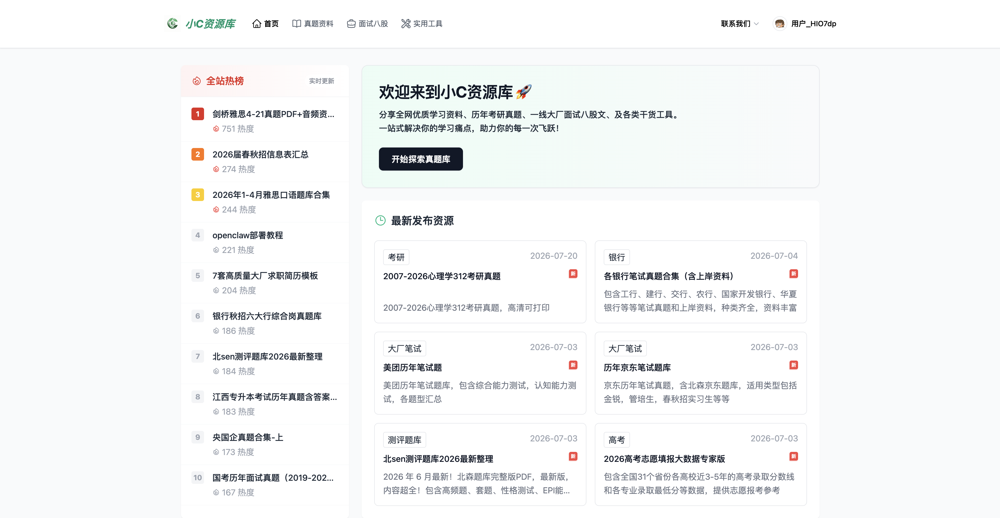
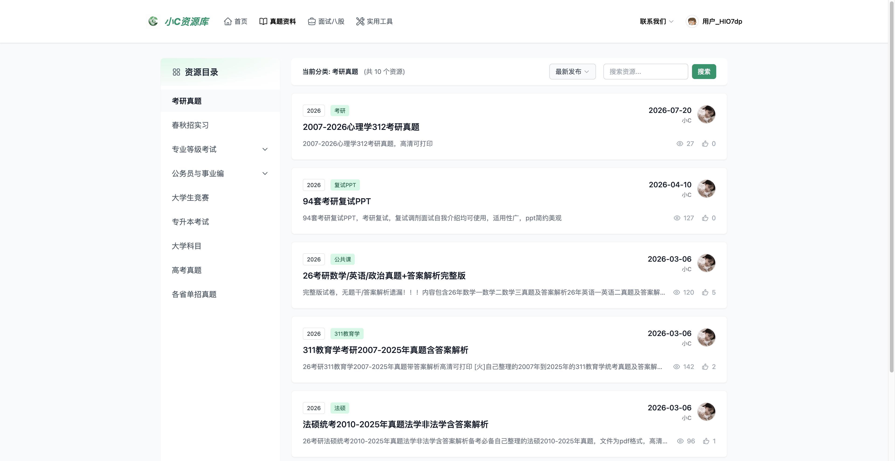
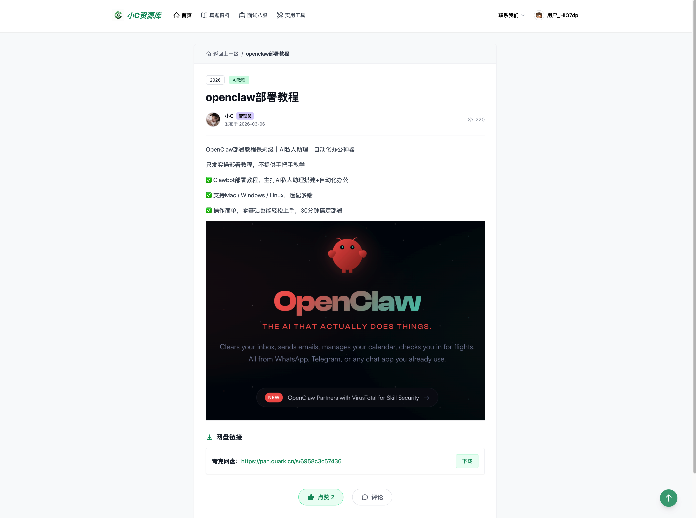
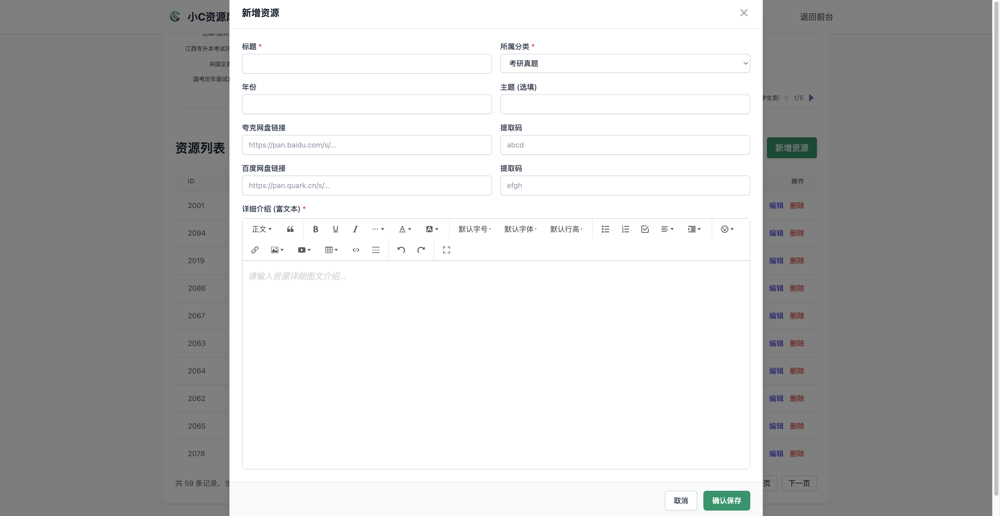
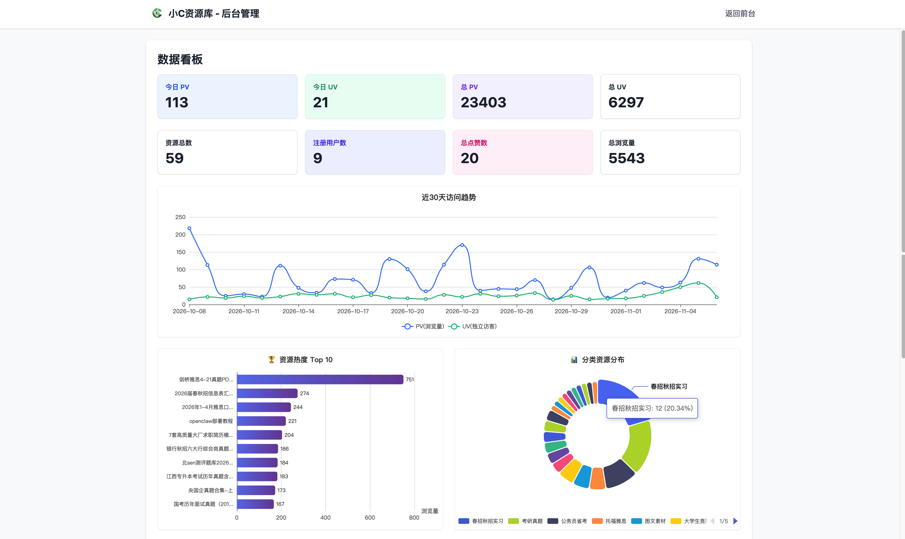
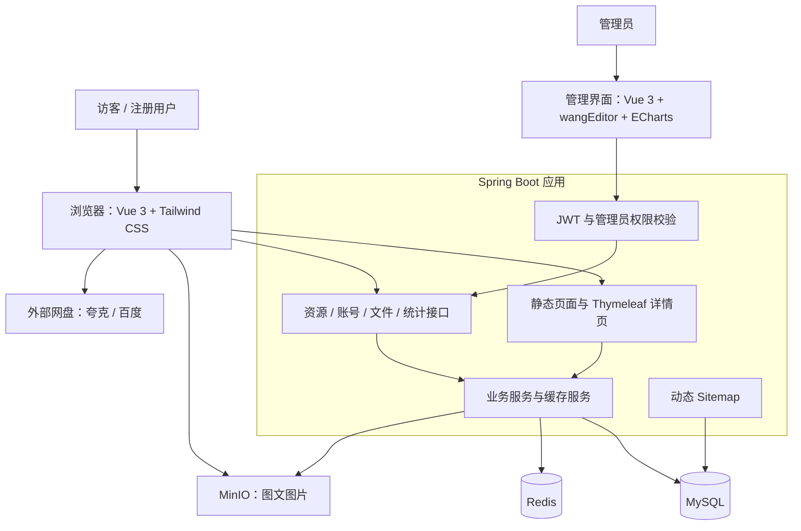

# 小C资源库 · XiaoC Library

**汇集学习资料、考试真题、面试八股与实用工具，让找资料更方便。**

[在线体验](https://xiaoclib.com/) · [功能展示](#功能展示) · [技术栈](#技术栈) · [系统架构](#系统架构) · [项目亮点](#项目亮点)

**Java 17 / Spring Boot 3 / Vue 3 / MySQL / Redis / MinIO**

> 本仓库为「小C资源库」的公开展示仓库，用于介绍产品功能、技术方案和界面效果。

## 项目介绍

小C资源库是一个面向学生、备考人群与开发者的学习资源聚合平台，通过分类导航、关键词搜索、热度排序和网盘下载入口，将分散的资料整理为便于查找的资源目录。

平台围绕三类内容组织资源：

| 内容方向 | 主要分类 |
| --- | --- |
| 真题与备考资料 | 考研、高考、四六级、计算机等级考试、公务员与事业编、专升本、大学生竞赛、大学科目、春秋招实习等 |
| 面试与技术学习 | Java、Python、前端、C/C++ 与嵌入式、编程语言与算法、数据库与中间件、人工智能与大数据、架构与设计模式等 |
| 实用工具与素材 | AI 工具、电脑工具、手机工具、图文素材等 |

项目同时提供资源管理后台与访问统计看板，支持从内容发布、资源检索到运营观察的日常管理流程。

## 在线体验

**访问地址：[https://xiaoclib.com/](https://xiaoclib.com/)**

推荐体验路径：浏览首页最新资源与全站热榜 → 选择资源分类 → 搜索关键词并调整排序 → 查看资源详情 → 通过网盘链接获取资料。

资源浏览、搜索与下载入口面向访客开放；管理后台供管理员使用。站内提供资料索引和外部网盘链接，具体下载流程以对应网盘服务为准。

## 核心功能

| 模块 | 已实现能力 |
| --- | --- |
| 首页发现 | 最新发布资源、全站热榜 Top 10，帮助用户快速发现近期内容与热门资料 |
| 分类导航 | 顶部内容分区、主分类与二级分类筛选，按不同学习场景组织资源 |
| 搜索与排序 | 标题关键词模糊搜索，支持按发布时间、浏览量、点赞量排序，提供分页浏览 |
| 资源详情 | 展示标题、年份、主题、发布者、发布时间、富文本介绍及浏览量 |
| 下载入口 | 支持夸克网盘、百度网盘链接与提取码展示，可跳转至对应网盘 |
| 点赞互动 | 支持点赞与取消点赞，暂未开放评论功能 |
| 账号功能 | 邮箱与密码注册、登录，使用 JWT 表示登录身份 |
| 资源管理 | 管理员新增、编辑、删除资源，维护分类归属、图文介绍和网盘链接 |
| 图片管理 | 富文本编辑器内上传图片，使用 MinIO 存储，支持删除图片 |
| 统计看板 | 展示访问统计、资源数、注册用户数、总点赞数，以及近 30 天访问趋势、资源热度 Top 10、分类资源分布 |

## 功能展示

### 首页：最新发布与全站热榜

集中展示最新资源与热门内容，提供清晰的内容入口。

 

### 资源列表：分类、搜索与排序

通过主分类、二级分类与标题关键词缩小查找范围，按时间、浏览量或点赞量切换排序。

 

### 资源详情：图文介绍与下载入口

展示资源说明、发布信息、浏览量与点赞操作，并提供网盘链接和提取码。

 

### 管理后台：资源发布与维护

通过表单与富文本编辑器维护资源内容，支持图片上传和两类网盘链接录入。

### 统计看板：访问趋势与资源分布

使用图表观察近 30 天访问趋势、热门资源与分类分布，辅助内容维护。

 

## 技术栈

| 层次 | 技术选型 | 用途 |
| --- | --- | --- |
| 前端交互 | Vue 3（Composition API）、原生 JavaScript | 首页、资源列表、账号页面与后台交互；通过静态脚本引入 Vue |
| 页面样式 | Tailwind CSS、自定义 CSS | 页面布局、响应式样式与组件外观 |
| 请求交互 | Fetch API、Axios | 前后端接口通信 |
| 后端服务 | Java 17、Spring Boot 3.5、Spring MVC | 资源、账号、文件与统计业务接口 |
| 页面模板 | Thymeleaf | 资源详情页服务端模板渲染与初始数据注入 |
| 数据访问 | MyBatis-Plus、Druid | 条件查询、分页、数据映射与连接池管理 |
| 数据存储 | MySQL 8 | 存储资源、分类、网盘链接、用户与每日访问统计 |
| 缓存与统计辅助 | Redis、Spring Data Redis | 首页与详情缓存、热榜排序、每日访客 IP 去重 |
| 图片存储 | MinIO | 富文本图片上传、访问与删除 |
| 身份与权限 | JWT、Spring MVC 拦截器 | 登录身份校验、管理接口角色校验 |
| 富文本编辑 | wangEditor | 资源图文内容编辑与图片上传 |
| 数据可视化 | Apache ECharts | 访问趋势折线图、热度排行柱状图、分类分布环形图 |
| 构建与部署支持 | Maven、Docker、Docker Compose | 应用打包与应用、数据库、缓存、对象存储的容器编排 |

## 系统架构

- **MySQL** 保存业务数据与每日访问统计。
- **Redis** 缓存最新资源、热榜和资源详情，并辅助每日访客去重。
- **MinIO** 保存图文介绍中的图片；学习资料通过外部网盘链接提供。
- **管理接口** 校验 JWT 及管理员角色，资源浏览与管理操作使用不同的访问规则。

## 项目亮点

### 1. 按访问场景设计缓存

首页最新资源采用 Redis String 缓存序列化列表；热门资源使用 Redis ZSet 按浏览量排序，并通过批量读取缓存组装榜单；资源详情采用旁路缓存，未命中时查询数据库并回填。资源新增、修改或删除时，按操作清理相关缓存，并结合过期时间控制缓存生命周期。

这些措施用于减少热点读取中的重复数据库查询，同时保留普通分类、搜索与分页查询路径。

### 2. 详情页渲染与搜索引擎发现

使用 Thymeleaf 为资源详情页生成动态标题、描述等元信息，并注入页面初始数据，由 Vue 承担点赞等交互。首页配置 Canonical 与 Open Graph 元信息，动态 Sitemap 根据已上架资源生成页面链接，为搜索引擎发现内容提供入口。

### 3. 减少列表查询的附加开销

列表按需返回展示字段，不附带网盘链接明细；网盘链接在详情查询中加载。发布者信息按当前页用户 ID 批量查询，再组装为展示对象，减少逐条查询带来的附加请求。

### 4. 内容编辑与图片存储配合

后台将 wangEditor 与 MinIO 图片上传接口结合，支持图文资源说明的编辑与维护。图片存储区分服务端访问地址和浏览器公开访问地址，适配容器内部通信与用户图片访问的不同路径。

### 5. 从访问记录到运营图表

后端通过拦截器记录访问请求，使用 Redis Set 对每日 IP 去重，并将统计结果写入 MySQL。管理端使用 ECharts 展示访问趋势、资源热度和分类分布。

其中，访客指标按 IP 统计，同一 IP 下的多个用户可能被合并；访问统计用于观察趋势。

### 6. 统一接口与日常维护

后端按 Controller、Service、Mapper 分层组织，使用 DTO 接收查询参数、VO 组织展示数据，并提供统一响应结构与全局异常处理。项目支持 Maven 打包与 Docker Compose 编排，便于维护应用及其依赖服务。

## 反馈与交流

欢迎通过本仓库 Issues 反馈页面问题、失效链接和功能建议，也可通过[网站](https://xiaoclib.com/)中的「联系我们」入口交流。反馈时请附上页面链接、问题描述与复现步骤。

如果这个项目对你有帮助，欢迎 Star 关注。

## 资源与权利说明

本站资源来自网络公开渠道的收集整理，仅供学习交流，请遵守相关权利人的授权与使用要求，勿用于商业用途。如涉及侵权，请通过网站联系入口反馈，以便核实处理。

